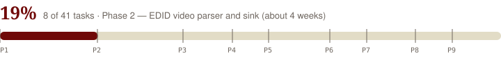
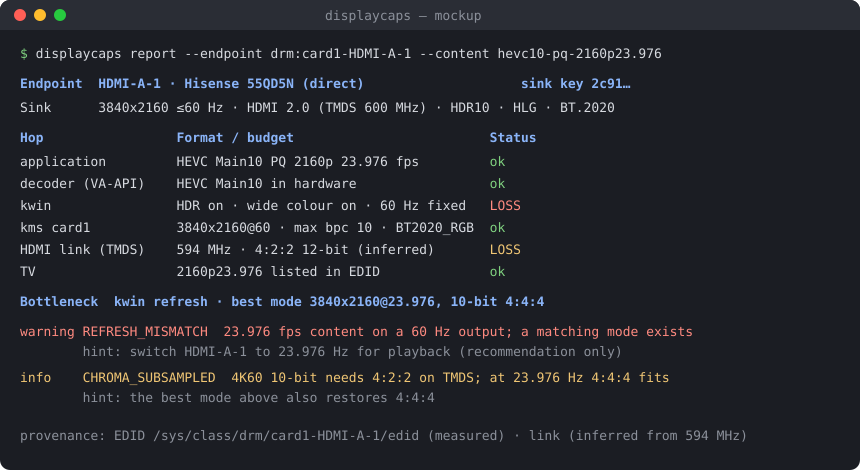

# DisplayCaps

<!-- progress:start · generated by scripts/repo-check.mjs progress; do not edit -->

**65% complete** · 27 of 41 tasks · Phase 6 — Decode layer, opt-in (about 2 weeks) · [Full progress page →](https://stealthx3.github.io/displaycaps/)
<!-- progress:end -->

> "DisplayCaps" is a working name; the final name is settled before 1.0.

DisplayCaps is a library that applications bundle to learn exactly what the
display path can show, and where anything is lost on the way. It covers the
whole path, from the connected TV, monitor or AV receiver back through the
HDMI/DisplayPort link, GPU driver and KMS, the compositor and the video decoder
to the application.

It is one of three libraries a project can choose from:

| Library | For apps that need |
| --- | --- |
| [AudioCaps](https://github.com/Stealthx3/audiocaps) | What audio the system can deliver (1.0.0 released) |
| **DisplayCaps** (this repo) | What the display path can show |
| Combined library (planned) | Both in one bundle, plus audio-video checks such as lip sync |

## The problem

A Linux application has no single, reliable way to ask: *"What can this display
really show through the path I use, and if something is missing, why?"* The
answer is spread across the sink's EDID, the GPU driver and KMS, the HDMI or DP
link, the compositor, the video decoder and the sandbox, and none of them
reports where a capability gets lost. Links silently drop to 4:2:0 or 8-bit,
range settings appear to do nothing, HDR is on but wide colour is off, films
play at 60 Hz with judder, and users end up reading kernel module parameters to
find out why.

## Goals

1. **Identify the connected sink and what it can do** — the specific TV,
   monitor, receiver or projector, its modes and refresh rates, colour formats
   and bit depths, HDR formats (HDR10, HLG, HDR10+, Dolby Vision), VRR range,
   ALLM and HDMI 2.1 limits, and what sits in between (receiver, adapter, dock).
2. **Host hardware capabilities** — GPU, connectors, supported link rates
   (TMDS, FRL, DP, DSC), max bpc, hardware video decode by codec and profile.
3. **Software capabilities** — what the driver, KMS, the compositor (HDR, wide
   colour, VRR, colour management), the decode drivers and the sandbox actually
   let through.
4. **End-to-end pipeline diagnostics** — the bandwidth and format budget at
   every hop, the bottleneck, and every point where resolution, refresh, bit
   depth, chroma, range, HDR or VRR is lost, with the fix.

Constraints: works fully inside **Flatpak and Snap**, and never disturbs what is
on screen: no modesets, no forced connector probes, no DDC/CI writes.

### Guiding principles

- **Information on-demand:** only what the application asks for is probed and returned.
- **The application decides:** every opt-in (decode checks, DDC/CI, CEC) runs only when the app calls it.
- **Few languages, bundled use:** a Rust core with a generated C header; apps bundle the library.
- **Recommend, never act:** DisplayCaps suggests the best mode for the content; the app or compositor applies it.

## Screenshots and mockups

*Mockup* of the planned `displaycaps report` output. Real screenshots replace it as the CLI lands.

## Features

All features are *(planned)* for Linux 1.0; the progress page above shows what is done.

- Scoped probing with immutable, lock-free snapshots and change events *(planned)*
- Endpoints for HDMI, DisplayPort, USB-C, eDP panels and virtual outputs, through adapters, docks and MST hubs *(planned)*
- Sink identification from the kernel's cached EDID with a Rust EDID, CTA-861 and DisplayID parser, optional DDC/CI and CEC reads, and per-model quirk data *(planned)*
- Read-only KMS state: active mode, max bpc, colorspace, colour format, HDR metadata, range, VRR *(planned)*
- Link-budget engine that infers the real TMDS/FRL/DP link, chroma and bit depth *(planned)*
- Compositor state on KWin, Mutter, wlroots and Gamescope through color-management-v1 and their output APIs; X11 RandR fallback *(planned)*
- Opt-in hardware decode checks through VA-API and Vulkan Video *(planned)*
- Per-presentation-path results (colour-managed Wayland, plain Wayland, X11, direct KMS) *(planned)*
- Path reports with per-hop bandwidth, bottleneck and a recommended mode for given content *(planned)*
- Declarative diagnostic rules with distro- and compositor-aware remediation hints *(planned)*
- Sandbox-aware: reports missing Flatpak permissions or Snap plugs with the exact fix *(planned)*
- Stable C ABI (`dc_` prefix), versioned JSON export with redaction, a CLI, mpv and SDL3 mapping guides, and Flatpak/Snap packaging templates *(planned)*
- Passive capture tool that saves a redacted system snapshot for bug reports and tests *(planned)*

Windows and macOS backends follow Linux 1.0 on the same OS-neutral core.

## Origin

DisplayCaps is an original project, not a fork, so there is no upstream to
credit or divergences to list. It starts from code copied from AudioCaps v1.0.0
by the same author (the generic core, the sink-key algorithm and the EDID
parser), which it then maintains separately; see NOTICE. First consumers:
Icefin Player (via mpv) and Argosy Desktop (via SDL3).

## Repository layout

| Path | Contents |
| --- | --- |
| `docs/` | Project documentation (see below) |
| `docs/plan/` | Local review copies of the development plan and local notes (git-ignored) |
| `CLAUDE.md` | Standing instructions for Claude Code |
| `LICENSE`, `NOTICE` | LGPL-2.1-or-later license text and notices |
| `scripts/` | Project tooling: progress page, repo check, lab VMs, phone alerts (from phase 1) |
| `crates/` | Cargo workspace: model, parse, link, backends, rules, ffi, cli (from phase 1) |
| `schema/` | Generated JSON schema v1 (from phase 1) |
| `tests/fixtures/` | Redacted system captures and their golden snapshots (from phase 1) |

## Documentation

- [Roadmap and task list](docs/PLAN.md)
- [Decision & action log](docs/DECISIONS.md)
- [Changelog](docs/CHANGELOG.md)
- [Documentation index](docs/README.md)

## License

LGPL-2.1-or-later. See [LICENSE](LICENSE) and [NOTICE](NOTICE).
